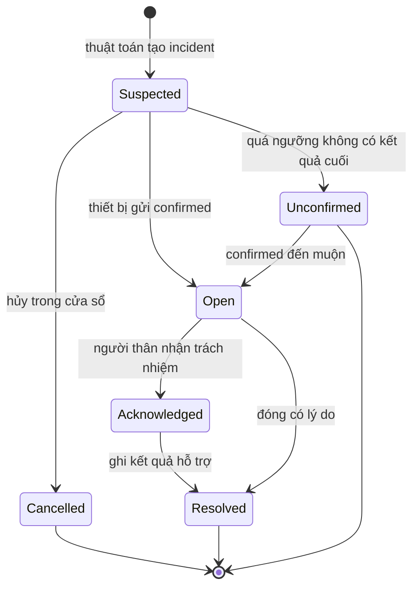

# Kiến trúc hệ thống

> **Baseline v0.1:** kiến trúc gốc chưa bao gồm đầy đủ AI execution, capability registry và cấu hình động. [Chương 11](11-nen-tang-ai-va-cau-hinh-dong.md) ghi hướng bổ sung cần chốt; đường cảnh báo vẫn phải hoạt động độc lập với model.

**Trạng thái 21/11/2026:** đã có web responsive + backend modular monolith + PGlite/PostgreSQL + simulator, cùng retention tùy chọn mặc định tắt. **Chưa có firmware ESP32**, broker thật hay AI runtime dài hạn. HTTP `POST /api/v1/ingest/*` là đường ingest đang hỗ trợ; MQTT chỉ là thử nghiệm có kiểm soát. Các mục dưới đây phân biệt rõ thiết kế với phần đã chạy.

**Đề xuất ban đầu:** web responsive + backend modular monolith + PostgreSQL + MQTT broker + firmware ESP32. Chưa khóa cloud hay nhà cung cấp AI.

## Các thành phần

> **Trạng thái truyền dữ liệu thiết bị (21/11/2026):** HTTP `POST /api/v1/ingest/*` với header `x-device-id`/`x-device-key` vẫn là **đường ingest chính thức**. Adapter MQTT trong backend subscribe `telemetry` + `events`, gọi chung service nghiệp vụ và publish ACK sự kiện sau commit; phần P0-2 đã có mã/test cục bộ. Tuy vậy đây vẫn là profile **thử nghiệm**: chưa kiểm broker/ACL/TLS thật, chưa có xác thực khóa thiết bị ở tầng ứng dụng (P0-1 mở), nên **không dùng MQTT cho demo cảnh báo**. Broker trong `infra/compose.yaml` nằm sau profile `mqtt-experimental`, tắt khi `docker compose up` mặc định, chỉ bind loopback và bắt buộc `password_file` + ACL theo `device_id`; xem [`infra/README.md`](../infra/README.md).

Các module ingest, cảnh báo, thông báo và AI nằm trong một backend triển khai chung ở bản đầu. Có thể chạy worker riêng cùng codebase khi cần khôi phục tác vụ; chưa có lý do để chia microservices hoặc thêm Kubernetes.

## Gán sự kiện theo assignment tại `measured_at`

Đây là thay đổi v2 quan trọng: dữ liệu đến muộn hoặc thiết bị đã chuyển chủ **không** được gán cho chủ đang mở tại thời điểm nhận.

- Server đọc lịch sử `device_assignments` và chọn assignment chứa `measured_at`; khoảng assignment là nửa mở `[started_at, ended_at)`. Dữ liệu đo trong assignment đã đóng thuộc chủ cũ; không chuyển sang hồ sơ mới.
- **Telemetry**: mẫu trong assignment đang mở/đã đóng được gán đúng assignment. Dung sai `MAX_CLOCK_SKEW_SECONDS` (mặc định 120 giây, cấu hình được) chỉ nới sát biên assignment; mẫu trước assignment đầu tiên, rơi vào khoảng trống hoặc vượt hiện tại quá ngưỡng bị **cách ly**. Mẫu `clock_status=unsynced`/`measured_at=null` được lưu vào assignment đang mở nhưng không lên timeline; `synced` mà thiếu `measured_at` bị từ chối 422.
- **Sự kiện incident**: tra toàn bộ lịch sử assignment theo `measured_at`, kiểm chính xác biên (không nới) và chỉ áp dung sai cho hướng tương lai. `measured_at=null`, trước assignment đầu tiên, ngoài khoảng assignment hoặc lệch tương lai quá ngưỡng bị cách ly. Nếu incident đã tồn tại nhưng assignment theo `measured_at` thuộc hồ sơ khác, bản tin bị từ chối với lý do `assignment_mismatch`; không ghi chéo chủ.
- **Telemetry bị cách ly** vẫn được ghi với `is_quarantined=true` để giữ dedupe/bằng chứng, trả HTTP **202 `accepted` + `code=QUARANTINED`**; không xuất hiện trong measurements/daily-summary/insights/export/dashboard. **Sự kiện incident bị cách ly** không tạo incident/outbox/SSE, trả **202 `rejected` + `code=QUARANTINED`**, `incidentId=null`.
- Audit `telemetry.quarantined`/`incident.quarantined` chỉ ghi id bản tin, thời gian, lý do, độ lệch và assignment; **không** ghi nhịp tim, bước chân, điện thoại hay evidence.

Không có màn hình quản trị vùng cách ly; hiện chỉ kiểm qua DB/audit và test. Đây là giới hạn cần bổ sung trước khi vận hành với thiết bị thật.

## SSE và thu hồi quyền

- Stream `GET /subjects/:id/events` yêu cầu phiên hợp lệ và quyền `canReceiveAlerts`; mỗi vòng poll kiểm lại **phiên còn hiệu lực + tài khoản còn `active` + care link còn hiệu lực**.
- Khi admin khóa tài khoản, phiên hết hạn hoặc care link bị thu hồi, server gửi `event: revoked` với payload rỗng rồi đóng stream. Client xóa cache hồ sơ và điều hướng an toàn; không tiếp tục nhận `alert.updated`.
- `revoked` không chứa lý do, id phiên, số đo hay thông tin hồ sơ khác. Reconnect dùng cursor/`Last-Event-ID`, nhưng phải qua kiểm quyền lại; không có “replay” dữ liệu đã mất quyền.
- Web hiển thị banner “Mất cập nhật trực tiếp — đang thử lại” khi stream lỗi; cảnh báo đã tải vẫn giữ, nhưng đây không phải bảo đảm thay thế Web Push.

## Công nghệ ứng viên

| Phần | Đề xuất ban đầu | Lý do và điều kiện xem lại |
| --- | --- | --- |
| Web | React + TypeScript + Vite | Dashboard tương tác, chia sẻ kiểu dữ liệu; đổi nếu nhóm có năng lực khác hoặc trường yêu cầu |
| API | NestJS + TypeScript | Tổ chức module theo nghiệp vụ; API, ingest và tác vụ dùng chung domain |
| Lưu trữ | PostgreSQL | Quan hệ hồ sơ/chia sẻ, transaction và unique constraint; chưa cần database chuỗi thời gian riêng |
| Thiết bị | ESP32, ESP-IDF, ESP-MQTT | Wi-Fi và MQTT/TLS; chọn board/version sau khảo sát thư viện cảm biến và bộ nhớ |
| MQTT broker | Mosquitto hoặc broker tương thích | **Chưa dùng trên đường ingest production**; adapter subscribe telemetry/events và publish ACK sự kiện, nhưng chưa kiểm broker/ACL/TLS thật và P0-1 còn mở. Cấu hình mẫu đã bỏ anonymous, bind loopback và nằm sau profile thử nghiệm |
| Realtime web | SSE hoặc WebSocket, chốt sau thử phiên đăng nhập | Server đẩy dữ liệu/cảnh báo; client reconnect phải lấy lại trạng thái từ API |
| AI | Adapter phía server | Đổi provider/model mà không đổi luồng cảnh báo; chưa chọn provider |
| Local demo | Compose khi đã có ứng dụng | Hiện chỉ dựng PostgreSQL (mặc định) và Mosquitto sau profile `mqtt-experimental`; API/web chạy `pnpm dev`, chưa có image |

Tài liệu chính thức ESP-IDF được đọc ngày 10/11/2026 cho biết ESP-MQTT đã tách thành component riêng từ ESP-IDF v6.0. Vì vậy khi bắt đầu firmware phải chốt bộ ESP-IDF + ESP-MQTT tương thích; không dùng ví dụ cũ mà mặc định component vẫn tích hợp. Nguồn ở [danh mục](10-nguon-va-cau-hoi-mo.md).

## Luồng cảnh báo té ngã

- Firmware là nơi quyết định kết thúc cửa sổ hủy, dùng đồng hồ monotonic. Tham số demo đề xuất là **20 giây**, chưa chốt sau thử thao tác; hiện **chưa có firmware** để kiểm.
- `fall.candidate` chỉ tạo trạng thái `suspected`. Backend **không tự suy ra confirmed** vì hết thời gian nhận dữ liệu: có thể thiết bị đã hủy khi mất mạng.
- Ứng viên quá hạn không có kết quả cuối được job nền chuyển sang `unconfirmed` (mặc định `SUSPECTED_TIMEOUT_MINUTES=10`, là chính sách demo). Đây là bản ghi “thiếu kết quả cuối”, không phải cảnh báo khẩn: không phát SSE, không tạo outbox; UI hiện “Chưa xác định” trong tab Đã đóng. Nếu `fall.confirmed` đến sau, incident mở lại thành `open` để không bỏ sót ca đã xác nhận.
- `fall.cancelled` trước confirmed kết thúc incident và không gửi cảnh báo khẩn tới người thân. Nếu đã confirmed, yêu cầu hủy sau đó được ghi là `user.cancel_requested`; backend đóng với lý do và thông báo cập nhật cho những người đã nhận, không xóa lịch sử.
- `fall.confirmed` mở cảnh báo ngay cả khi `candidate` chưa tới. `incident_id` ổn định, `event_revision` tăng trong cùng incident; dữ liệu đến trễ không được làm lùi trạng thái cuối.
- SOS là incident riêng, mở trực tiếp sau thao tác xác nhận chủ động, không đợi 20 giây của nghi ngã.
- Người thân `acknowledged` chỉ có nghĩa đã nhận trách nhiệm hỗ trợ, không đồng nghĩa người dùng đã an toàn. Chỉ `resolved` có kết quả và người thực hiện mới kết thúc xử lý.

## Tính bền vững và gửi thông báo

Tiếp nhận sự kiện và tạo bản ghi cần gửi trong cùng transaction. Worker đọc notification outbox, thử gửi với backoff và số lần tối đa cấu hình được, lưu lỗi và lần thử. Unique key ngăn cùng incident/revision/người nhận/kênh tạo nhiều tác vụ gửi.

MQTT QoS 1 vẫn có thể giao trùng. ACK của broker không có nghĩa ứng dụng đã lưu. Thiết bị chỉ coi sự kiện quan trọng đã tới backend khi nhận **application ACK sau commit**; nếu chưa có thì gửi lại cùng định danh. Bộ nhớ bền của thiết bị, dung lượng và cách phục hồi sau mất nguồn phải được hiện thực riêng và kiểm chứng. Không coi outbox mặc định của thư viện là flash queue được bảo đảm.

Kết nối realtime cũng có thể đứt. Web tải snapshot/cursor từ API khi reconnect; trạng thái server là nguồn chính. Gửi thành công tới kết nối không đồng nghĩa người dùng đã đọc; `acknowledged` phải là hành động rõ ràng.

## Retention dữ liệu theo tuổi

Job `retention` **mặc định tắt**, không có ngày mặc định. Khi bật bằng `RETENTION_ENABLED=true` và cấu hình ít nhất một `RETENTION_*_DAYS`, job chạy một lần/ngày theo UTC, xóa theo lô 500 và ghi audit `retention.purge` với cutoff + số dòng:

- `telemetry` theo `received_at`;
- `notification_outbox` chỉ ở trạng thái kết thúc (`sent`/`failed`/`superseded`), không xóa `pending`;
- `realtime_events`;
- `ai_summaries`;
- `assistant_drafts` đã hết hạn theo `expires_at` (không xóa nháp còn hiệu lực).

Job không xóa hồ sơ, incident, audit, care link, cấu hình, backup hay nháp còn hiệu lực; không thay endpoint `deletion-requests` (vẫn chỉ ghi audit). `job_runs` chỉ chống chạy lặp trong ngày trên **một tiến trình**; chưa có advisory lock, chưa kiểm PostgreSQL thật và chưa có API/UI cấu hình. Admin có `GET /admin/retention/preview` chỉ đọc, đếm theo env hiện tại nhưng không xóa/không ghi `job_runs`. Chi tiết/bằng chứng: [`reports/qa/v12-retention.md`](../reports/qa/v12-retention.md).

## Trợ lý có hành động có kiểm soát

FR-21 backend tách **nháp** khỏi **ghi nghiệp vụ**: `assistant_drafts` lưu payload đã chuẩn hoá, digest, hạn 15 phút và trạng thái `draft|confirmed|cancelled|expired`. Tạo nháp không ghi `care_reminders`; chỉ `confirm` của chủ hồ sơ mới gọi `RemindersService.createWithTx` trong cùng transaction với cập nhật nháp, nên lặp lại không tạo lịch thứ hai. Hết hạn, hủy, digest sai hoặc mất quyền bị chặn trước khi ghi.

Trợ lý **không** có capability tự xác nhận/đóng/hủy cảnh báo, đổi cấu hình thiết bị, cấp quyền, xóa dữ liệu, chẩn đoán/kê đơn, gửi tin khẩn hay điều khiển firmware. Catalog trả qua `GET /subjects/:id/assistant/capabilities`.

Câu lệnh đơn giản có thể đi qua parser rule-based (`POST /subjects/:id/assistant/drafts/from-text`): hiểu giờ, “hằng ngày”, khoảng thứ 2–6 và “mai”, nhưng **không gọi LLM**, không suy luận liều lượng/ngày kết thúc; mặc định cả tuần nếu không nêu thứ, dời sang mai nếu mọi giờ hôm nay đã qua, và vẫn chỉ tạo nháp. `PATCH /assistant/drafts/:id` cho phép chủ hồ sơ sửa preview trước confirm; sửa nháp không ghi nghiệp vụ, cập nhật digest để confirm cũ bị chặn. `GET /subjects/:id/assistant/drafts` trả các nháp còn hạn để UI khôi phục sau khi tải lại. Đây là backend của FR-21; chưa có UI preview.

## Mạng, đồng hồ và dữ liệu cũ

| Tình huống | Hành vi đề xuất |
| --- | --- |
| Mất Wi-Fi | Thiết bị vẫn đọc cảm biến, báo tại chỗ và ghi hàng đợi hữu hạn; UI từ xa đánh dấu offline khi vượt timeout |
| Mất nguồn | Chỉ dữ liệu đã ghi bền có thể phục hồi; khi boot tạo `boot_id` mới, công bố reset counter |
| Chưa đồng bộ giờ | Gửi `measured_at: null`, uptime và `clock_status: unsynced`; không lấy giờ nhận làm giờ đo thật |
| Sự kiện đến muộn | Giữ thời gian gốc; UI ghi “nhận trễ”; không tự khẳng định nguy cơ đang diễn ra |
| Chuyển thiết bị sang hồ sơ khác | Dữ liệu được gán bằng lịch sử assignment tại thời điểm xảy ra; không chắc thời gian thì cách ly để kiểm tra |
| Candidate không có kết quả cuối | Hiển thị “chưa xác định do thiếu dữ liệu”; không báo bình thường và không tự xác nhận ngã |

Tham số demo đề xuất: heartbeat 15 giây, offline sau 45 giây không có heartbeat, dữ liệu chỉ số bị coi là cũ sau 30 giây. Cần điều chỉnh theo chu kỳ gửi/pin. LWT là tín hiệu bổ sung, không thay việc theo dõi thời gian nhận cuối.

Một confirmed đến trễ hơn 5 phút hoặc không xác định được giờ được lưu vào lịch sử, gắn cờ cần kiểm tra và gửi thông báo “sự kiện nhận trễ, chưa rõ tình trạng hiện tại”. Ngưỡng 5 phút là chính sách demo đề xuất, phải đánh giá lại; không âm thầm bỏ cảnh báo.

## Ranh giới quyền và vận hành

Broker, **khi được bật ở profile thử nghiệm**, chỉ cho thiết bị đăng nhập bằng user riêng và publish/subscribe topic của chính `device_id`; API vẫn phải xác minh payload khớp định danh kết nối vì ACL chưa được kiểm với broker thật. Adapter MQTT subscribe `v1/devices/+/telemetry` và `v1/devices/+/events`, publish ACK sự kiện; chỉ là profile thử nghiệm, chưa kiểm broker/ACL/TLS thật và chưa xác thực khóa thiết bị ở tầng ứng dụng. HTTP là đường ingest chính thức.

API kiểm quyền theo hồ sơ trước truy vấn dữ liệu, đăng ký realtime, xuất báo cáo và gọi AI. Từ v2, quyền xem số đo (`canViewMeasurements`) là cổng riêng, không dùng chung với quyền nhận cảnh báo; trợ lý AI cần cả quyền xem số đo và `canViewAi`. Thu hồi quyền phải ngắt stream và hủy quyền của tác vụ gửi chưa thực hiện. Admin kỹ thuật không mặc định là người xem sức khỏe.

Backup, restore, secret rotation, giới hạn retention và quan sát lỗi được mô tả ở [lộ trình/bàn giao](09-lo-trinh-va-ho-so.md); cần bằng chứng trước khi dùng dữ liệu thật.
