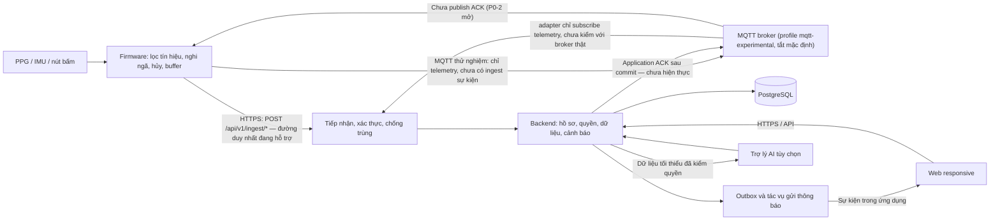
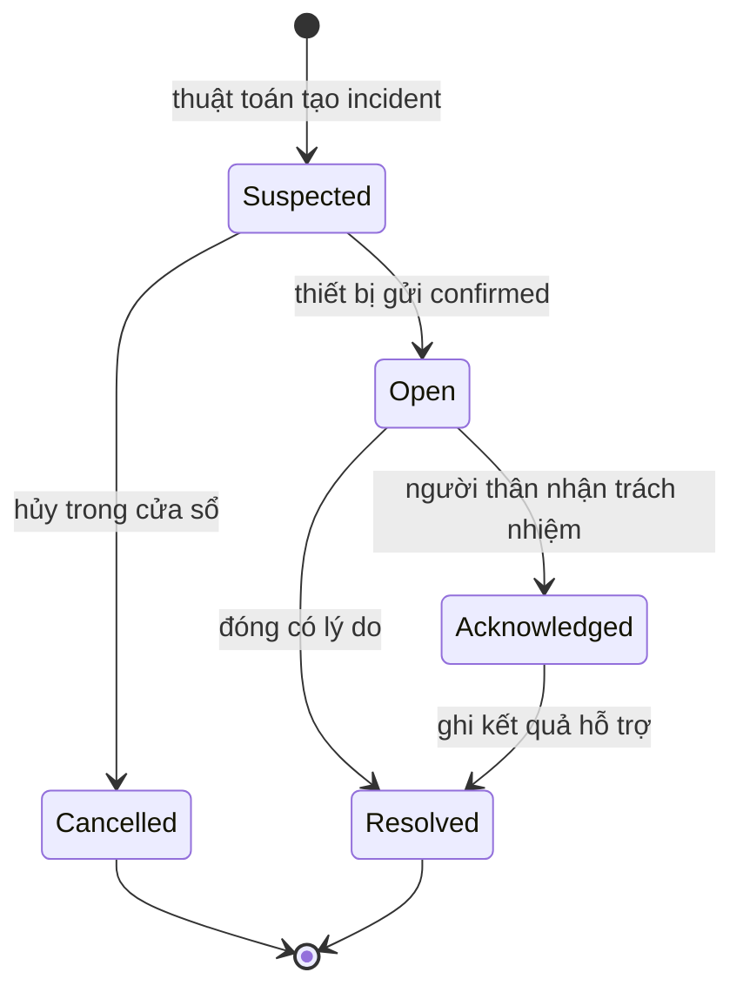

# Kiến trúc hệ thống

> **Baseline v0.1:** kiến trúc dưới đây chưa bao gồm đầy đủ AI execution, capability registry và cấu hình động. [Chương 11](11-nen-tang-ai-va-cau-hinh-dong.md) ghi hướng bổ sung cần chốt; đường cảnh báo vẫn phải hoạt động độc lập với model.

**Đề xuất v0.1:** web responsive + backend modular monolith + PostgreSQL + MQTT broker + firmware ESP32. Chưa khóa framework, phiên bản, cloud hay nhà cung cấp AI.

## Các thành phần

> **Trạng thái truyền dữ liệu thiết bị (15/11/2026):** HTTP `POST /api/v1/ingest/*` với header `x-device-id`/`x-device-key` là **đường duy nhất đang được hỗ trợ và đã chạy**. Adapter MQTT trong backend chỉ subscribe telemetry khi đặt `MQTT_URL`; chưa có ingest `fall.*`/`sos.*`/`status`, chưa publish ACK, nên publish sự kiện lên broker **không tạo incident và không có ACK** (finding P0-2 vẫn mở). Broker trong `infra/compose.yaml` nằm sau profile `mqtt-experimental`, tắt khi `docker compose up` mặc định, chỉ bind loopback và bắt buộc `password_file` + ACL theo `device_id`; xem [`infra/README.md`](../infra/README.md). Đây là **giảm bề mặt tấn công và ghi đúng thực tế**, không phải đã triển khai MQTT hay đã xác thực thiết bị trên MQTT.

Các module ingest, cảnh báo, thông báo và AI nằm trong một backend triển khai chung ở bản đầu. Có thể chạy worker riêng cùng codebase khi cần khôi phục tác vụ; chưa có lý do để chia microservices hoặc thêm Kubernetes.

## Công nghệ ứng viên

| Phần | Đề xuất ban đầu | Lý do và điều kiện xem lại |
| --- | --- | --- |
| Web | React + TypeScript + Vite | Dashboard tương tác, chia sẻ kiểu dữ liệu; đổi nếu nhóm có năng lực khác hoặc trường yêu cầu |
| API | NestJS + TypeScript | Tổ chức module theo nghiệp vụ; API, ingest và tác vụ dùng chung domain |
| Lưu trữ | PostgreSQL | Quan hệ hồ sơ/chia sẻ, transaction và unique constraint; chưa cần database chuỗi thời gian riêng |
| Thiết bị | ESP32, ESP-IDF, ESP-MQTT | Wi-Fi và MQTT/TLS; chọn board/version sau khảo sát thư viện cảm biến và bộ nhớ |
| MQTT broker | Mosquitto hoặc broker tương thích | **Chưa dùng trên đường ingest**; adapter chỉ subscribe telemetry. Cấu hình mẫu đã bỏ anonymous, bind loopback và nằm sau profile thử nghiệm; ACL/TLS/hosting/persistence phải thử trước khi dùng |
| Realtime web | SSE hoặc WebSocket, chốt sau thử phiên đăng nhập | Server đẩy dữ liệu/cảnh báo; client reconnect phải lấy lại trạng thái từ API |
| AI | Adapter phía server | Đổi provider/model mà không đổi luồng cảnh báo; chưa chọn provider |
| Local demo | Compose khi đã có ứng dụng | Hiện chỉ dựng PostgreSQL (mặc định) và Mosquitto sau profile `mqtt-experimental`; API/web chạy `pnpm dev`, chưa có image |

Tài liệu chính thức ESP-IDF được đọc ngày 10/11/2026 cho biết ESP-MQTT đã tách thành component riêng từ ESP-IDF v6.0. Vì vậy khi bắt đầu firmware phải chốt bộ ESP-IDF + ESP-MQTT tương thích; không dùng ví dụ cũ mà mặc định component vẫn tích hợp. Nguồn ở [danh mục](10-nguon-va-cau-hoi-mo.md).

## Luồng cảnh báo té ngã

- Firmware là nơi quyết định kết thúc cửa sổ hủy, dùng đồng hồ monotonic. Tham số demo đề xuất là **20 giây**, chưa chốt sau thử thao tác.
- `fall.candidate` chỉ tạo trạng thái `suspected`. Backend **không tự suy ra confirmed** vì hết thời gian nhận dữ liệu: có thể thiết bị đã hủy khi mất mạng.
- `fall.cancelled` trước confirmed kết thúc incident và không gửi cảnh báo khẩn tới người thân. Nếu đã confirmed, yêu cầu hủy sau đó được ghi là `user.cancel_requested`; backend đóng với lý do và thông báo cập nhật cho những người đã nhận, không xóa lịch sử.
- `fall.confirmed` mở cảnh báo ngay cả khi `candidate` chưa tới. `incident_id` ổn định, `event_revision` tăng trong cùng incident; dữ liệu đến trễ không được làm lùi trạng thái cuối.
- SOS là incident riêng, mở trực tiếp sau thao tác xác nhận chủ động, không đợi 20 giây của nghi ngã.
- Người thân `acknowledged` chỉ có nghĩa đã nhận trách nhiệm hỗ trợ, không đồng nghĩa người dùng đã an toàn. Chỉ `resolved` có kết quả và người thực hiện mới kết thúc xử lý.

## Tính bền vững và gửi thông báo

Tiếp nhận sự kiện và tạo bản ghi cần gửi trong cùng transaction. Worker đọc notification outbox, thử gửi với backoff và số lần tối đa cấu hình được, lưu lỗi và lần thử. Unique key ngăn cùng incident/revision/người nhận/kênh tạo nhiều tác vụ gửi.

MQTT QoS 1 vẫn có thể giao trùng. ACK của broker không có nghĩa ứng dụng đã lưu. Thiết bị chỉ coi sự kiện quan trọng đã tới backend khi nhận **application ACK sau commit**; nếu chưa có thì gửi lại cùng định danh. Bộ nhớ bền của thiết bị, dung lượng và cách phục hồi sau mất nguồn phải được hiện thực riêng và kiểm chứng. Không coi outbox mặc định của thư viện là flash queue được bảo đảm.

Kết nối realtime cũng có thể đứt. Web tải snapshot/cursor từ API khi reconnect; trạng thái server là nguồn chính. Gửi thành công tới kết nối không đồng nghĩa người dùng đã đọc; `acknowledged` phải là hành động rõ ràng.

## Mạng, đồng hồ và dữ liệu cũ

| Tình huống | Hành vi đề xuất |
| --- | --- |
| Mất Wi-Fi | Thiết bị vẫn đọc cảm biến, báo tại chỗ và ghi hàng đợi hữu hạn; UI từ xa đánh dấu offline khi vượt timeout |
| Mất nguồn | Chỉ dữ liệu đã ghi bền có thể phục hồi; khi boot tạo `boot_id` mới, công bố reset counter |
| Chưa đồng bộ giờ | Gửi `measured_at: null`, uptime và `clock_status: unsynced`; không lấy giờ nhận làm giờ đo thật |
| Sự kiện đến muộn | Giữ thời gian gốc; UI ghi “nhận trễ”; không tự khẳng định nguy cơ đang diễn ra |
| Chuyển thiết bị sang hồ sơ khác | Dữ liệu được gán bằng lịch sử assignment tại thời điểm xảy ra; không chắc thời gian thì cách ly để kiểm tra |
| Candidate không có kết quả cuối | Hiển thị “chưa xác định do thiếu dữ liệu”; không báo bình thường và không tự xác nhận ngã |

Tham số demo đề xuất: heartbeat 15 giây, offline sau 45 giây không có heartbeat, dữ liệu chỉ số bị coi là cũ sau 30 giây. Cần điều chỉnh theo chu kỳ gửi/pin. LWT là tín hiệu bổ sung, không thay việc theo dõi thời gian nhận cuối.

Một confirmed đến trễ hơn 5 phút hoặc không xác định được giờ được lưu vào lịch sử, gắn cờ cần kiểm tra và gửi thông báo “sự kiện nhận trễ, chưa rõ tình trạng hiện tại”. Ngưỡng 5 phút là chính sách demo đề xuất, phải đánh giá lại; không âm thầm bỏ cảnh báo.

## Ranh giới quyền và vận hành

Broker, **khi được bật ở profile thử nghiệm**, chỉ cho thiết bị đăng nhập bằng user riêng và publish/subscribe topic của chính `device_id`; API vẫn phải xác minh payload khớp định danh kết nối vì ACL chưa được kiểm với broker thật. API kiểm quyền theo hồ sơ trước truy vấn dữ liệu, đăng ký realtime, xuất báo cáo và gọi AI. Thu hồi quyền phải ngắt stream và hủy quyền của tác vụ gửi chưa thực hiện. Admin kỹ thuật không mặc định là người xem sức khỏe.

Backup, restore, secret rotation, giới hạn retention và quan sát lỗi được mô tả ở [lộ trình/bàn giao](09-lo-trinh-va-ho-so.md); cần bằng chứng trước khi dùng dữ liệu thật.
