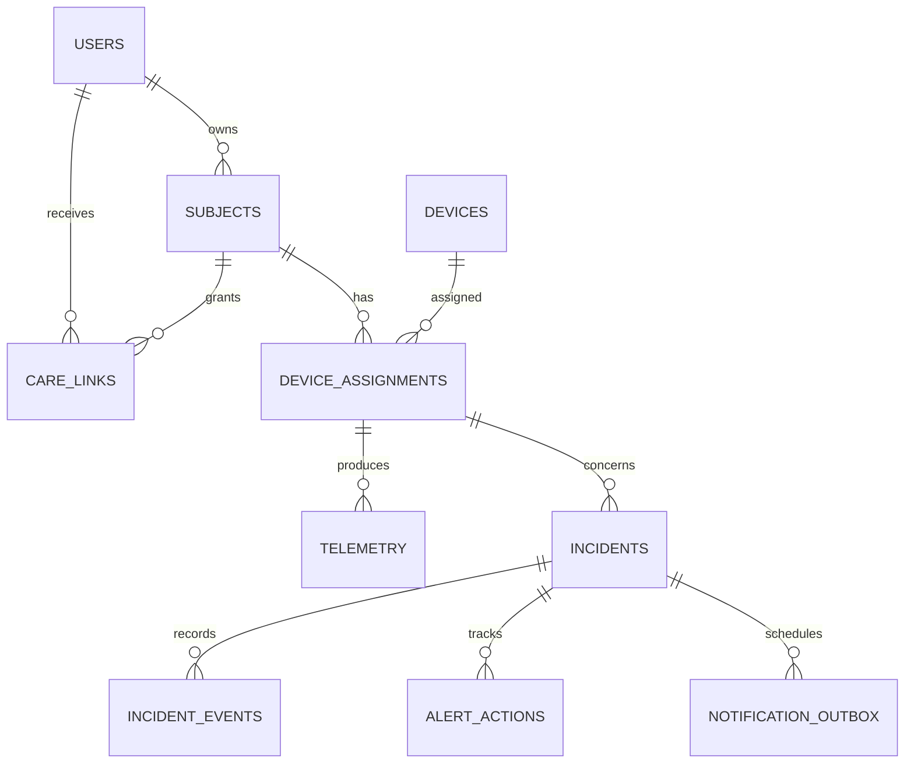

# Dữ liệu và giao tiếp

**Trạng thái:** hợp đồng dự thảo v1; chưa phải OpenAPI/JSON Schema đã thực thi. Ví dụ hợp lệ về cấu trúc JSON ở [packages/contracts](../packages/contracts/README.md), chỉ dùng dữ liệu tổng hợp.

## Mô hình dữ liệu

| Thực thể | Trường chính dự kiến | Ràng buộc quan trọng |
| --- | --- | --- |
| `users` | id, auth identity, trạng thái | Không dùng role toàn cục thay kiểm quyền trên hồ sơ |
| `subjects` | id, owner_user_id, tên hiển thị, timezone | Tách người được theo dõi khỏi tài khoản đăng nhập |
| `care_links` | subject_id, caregiver_user_id, permissions, shared_from, accepted_at, revoked_at | Chỉ active sau chấp nhận; giới hạn lịch sử được xem; kiểm lại trước khi gửi dữ liệu |
| `devices` | id, credential_ref, firmware_version, last_seen_at | Không lưu secret thô trong log hoặc hợp đồng công khai |
| `device_assignments` | id, device_id, subject_id, started_at, ended_at | Các khoảng không chồng nhau trên một thiết bị; không viết lại lịch sử khi đổi chủ |
| `telemetry` | message_id, device_id, assignment_id, boot_id, sequence, measured_at, received_at, metrics, quality | Chống trùng; assignment được server xác định và giữ nguyên |
| `incidents` | id, assignment_id, type, state, last_revision, detected_at, resolved_at | State transition kiểm tra trong transaction; không cho sự kiện cũ mở lại incident đã đóng |
| `incident_events` | message_id, incident_id, event_revision, type, payload, received_at | Lưu lịch sử bất biến; unique incident_id + event_revision |
| `alert_actions` | incident_id, actor_id, action, reason, created_at | Ai xác nhận/đóng và vì sao; bảo vệ tranh chấp bằng version/transaction |
| `notification_outbox` | incident_id, revision, recipient_id, channel, status, attempts, next_attempt_at | Unique theo incident/revision/người nhận/kênh; kiểm quyền lại lúc gửi |
| `ai_summaries` | subject_id, period, aggregate_ref, source_ids, model_version, status | Chỉ lưu theo chính sách được đồng ý; mất quyền thì không đọc lại qua cache |
| `audit_logs` | actor_id, action, target_ref, outcome, created_at | Không chứa toàn bộ payload sức khỏe, credentials hay prompt riêng tư |

Khóa/index dự kiến: unique `(device_id, message_id)`, unique `(device_id, boot_id, sequence)` cho envelope thiết bị; index `(assignment_id, measured_at)` cho truy vấn biểu đồ và `(state, detected_at)` cho cảnh báo. `message_id` phải được giữ nguyên khi retry; `sequence` tăng chung cho các bản tin trong một boot. Cùng key nhưng khác nội dung là xung đột, không âm thầm overwrite.

## Hợp đồng telemetry

| Trường | Quy tắc |
| --- | --- |
| `schema_version` | `1.0` cho bản dự thảo này; version không hỗ trợ bị từ chối/cách ly có lý do |
| `message_id`, `device_id`, `boot_id` | Định danh không chứa tên/số điện thoại; ví dụ dùng ID minh họa |
| `sequence` | Số nguyên không âm; tăng trong cùng boot, giữ khi gửi lại |
| `measured_at` | RFC 3339 UTC hoặc `null` khi chưa có đồng hồ tin cậy |
| `clock_status` | `synced` hoặc `unsynced`; `unsynced` đi với `measured_at: null` |
| `uptime_ms` | Thời gian monotonic tính từ boot; không so trực tiếp giữa hai boot |
| `metrics.heart_rate_bpm` | Số hoặc `null`; chỉ số không hợp lệ phải là `null`, không dùng 0 giả |
| `metrics.steps_since_boot` | Tổng bước của boot hiện tại, số nguyên không âm; không phải tổng ngày |
| `quality.heart_rate` | `valid`, `poor_signal`, `not_worn` hoặc `sensor_error` |
| `quality.motion` | `valid` hoặc `sensor_error`; lỗi cảm biến không tự thành ít vận động |
| `battery_percent` | Số 0–100 hoặc `null` khi chưa có phép đo/cấu hình chuyển đổi |
| `firmware_version` | Phiên bản tạo payload; phiên bản demo không đại diện firmware đã build |

Server bổ sung `received_at`, `assignment_id` và cờ dữ liệu trễ. Firmware không được tự khai người được theo dõi. Khi không đủ bằng chứng để gán dữ liệu vào lịch sử assignment, giữ bản tin ở vùng cách ly; không tự gán vào chủ hiện tại.

Tổng bước theo ngày được tính từ delta trong từng boot và gán vào khoảng có thời gian tin cậy. Lần nhận đầu của boot sau một đoạn mất dữ liệu có thể không phân bổ chính xác theo ngày; đánh dấu chưa đủ dữ liệu thay vì cộng toàn bộ vào ngày nhận. Khi counter giảm trong cùng boot, ghi lỗi dữ liệu. Ngày hiển thị theo timezone hồ sơ; lưu timestamp UTC.

## Topic và giao nhận MQTT

| Topic | Hướng | Payload/chính sách |
| --- | --- | --- |
| `v1/devices/{device_id}/telemetry` | Thiết bị → backend | Envelope telemetry; QoS 1 đề xuất, có thể tổng hợp mẫu để giảm băng thông |
| `v1/devices/{device_id}/events` | Thiết bị → backend | `fall.candidate`, `fall.cancelled`, `fall.confirmed`, `user.cancel_requested`, `sos.confirmed`; QoS 1 |
| `v1/devices/{device_id}/status` | Thiết bị/broker → backend | Presence/heartbeat gồm boot_id, uptime, firmware, pin nếu có; LWT chỉ là gợi ý mất kết nối |
| `v1/devices/{device_id}/acks` | Backend → thiết bị | ACK ứng dụng cho sự kiện quan trọng sau commit |

Không retain telemetry hoặc sự kiện té ngã: subscriber mới không được hiểu một sự kiện cũ là mới. Có thể retain presence, nhưng phải kiểm thời gian nhận. Topic status dùng cùng envelope định danh khi do thiết bị gửi; LWT do broker gửi phải được nhận diện riêng và không đưa vào bảng dữ liệu đo.

ACL buộc `device_id` trong topic và payload khớp định danh đã cấp. Subscriber backend không tin một device_id chỉ vì JSON hợp lệ. Certificate/credential provisioning và rotation được chọn khi dựng broker; không dùng chung một tài khoản thiết bị cho mọi board.

## Incident và ACK

Sự kiện dùng envelope như telemetry, thay `metrics` bằng `incident_id`, `event_revision`, `event_type` và `evidence`. `event_revision` bắt đầu 1 ở candidate, tăng theo từng thay đổi của incident và cần phục hồi được sau reboot nếu incident còn mở. `fall.confirmed` phải mang đủ dữ liệu để xử lý khi candidate chưa đến.

`evidence.algorithm_version`, vị trí đeo và cờ chất lượng giúp giải thích nguyên nhân; không gọi một điểm heuristic là “xác suất té ngã” nếu chưa hiệu chuẩn.

ACK gồm `source_message_id`, `incident_id`, `accepted_revision`, `status`, `received_at`. `accepted` nghĩa server đã ghi bền; `duplicate` nghĩa bản tin giống hệt đã được ghi. `rejected` kèm mã lý do để không retry vô hạn. Thiết bị chỉ xóa sự kiện khỏi hàng đợi sau ACK accepted/duplicate đúng định danh; bản tin bị reject chuyển vùng lỗi hữu hạn để kiểm tra.

Nếu revision mới tới trước revision cũ, server lưu lịch sử và áp dụng transition hợp lệ theo revision mới; bản cũ tới sau không làm lùi trạng thái. Hai payload khác nhau cùng revision là lỗi giao thức cần audit. Chuyển `cancelled` sang `open` bằng dữ liệu cũ bị cấm.

## API dự kiến

Prefix `/api/v1`; đây là inventory thiết kế, chưa có endpoint chạy.

| Nhóm | Endpoint minh họa | Kiểm quyền/hành vi |
| --- | --- | --- |
| Phiên | `POST /auth/register`, `/auth/login`, `/auth/logout`; `GET /me` | Session cookie bảo vệ phù hợp, rate limit, CSRF với thao tác dùng cookie; chốt cơ chế khi chọn stack |
| Hồ sơ | `GET /subjects`, `GET /subjects/{id}` | Chỉ hồ sơ sở hữu/được chia sẻ |
| Chia sẻ | `POST /subjects/{id}/invitations`; `POST /invitations/{token}/accept`; `DELETE /subjects/{id}/care-links/{link_id}` | Chủ hồ sơ tạo/thu hồi; token dùng một lần, có hạn; không ghi token vào log |
| Thiết bị | `POST /devices/claim`; `POST /devices/{id}/release` | Bằng chứng ghép thiết bị dùng một lần; assignment được đóng/mở đúng thời điểm |
| Chỉ số | `GET /subjects/{id}/measurements?from=&to=&cursor=` | Giới hạn khoảng, pagination và quyền lịch sử |
| Tổng hợp | `GET /subjects/{id}/daily-summary?date=` | Trả coverage, khoảng thiếu và timezone bên cạnh giá trị |
| Cảnh báo | `GET /subjects/{id}/alerts`; `POST /alerts/{id}/acknowledge`; `POST /alerts/{id}/resolve` | Quyền hỗ trợ; đóng phải có reason; dùng version và idempotency key |
| Realtime | `GET /subjects/{id}/events` nếu chọn SSE | Xác thực stream, thu hồi quyền, reconnect bằng cursor/snapshot |
| AI | `POST /subjects/{id}/assistant/summary` | Kiểm quyền trước tổng hợp và trước trả kết quả; giới hạn dữ liệu/chi phí |
| Dữ liệu cá nhân | `POST /subjects/{id}/exports`; `POST /subjects/{id}/deletion-requests` | Chủ hồ sơ hoặc đại diện được xác minh; export có hạn; theo dõi tiến trình xóa |
| Admin | `GET /admin/devices`, `GET /admin/audit` | Quyền quản trị; không cung cấp payload sức khỏe mặc định |

Lỗi API dùng envelope `{ "code": "...", "message": "...", "request_id": "..." }`; không trả stack trace hoặc thông tin hồ sơ khác. Dùng `401` khi không có phiên, `403` khi bị cấm theo chính sách, `409` khi xung đột trạng thái/version theo contract nghiệp vụ, `422` khi payload không phù hợp hợp đồng, `429` khi vượt giới hạn. Nếu dùng conditional update với `If-Match`/strong ETag, precondition không thỏa thì trả `412 Precondition Failed`, không thay bằng `409`. Quy ước này đối chiếu RFC 9110; endpoint phải nói rõ ETag thuộc tài nguyên nào, xem [đặc tả AI, mục 9](13-dac-ta-thuc-thi-ai-va-cau-hinh.md). Với tài nguyên riêng tư cần thống nhất cách dùng `404` để tránh dò tồn tại.

## Retention và xóa

Trước dữ liệu thật, chốt thời hạn cho raw signal, telemetry tổng hợp, audit, AI và backup. Raw IMU/PPG chỉ thu trong phiên thử có mục đích, không truyền/lưu liên tục mặc định. Một yêu cầu xóa phải xét database, file export, cache, tóm tắt AI và vòng đời backup; không ghi “đã xóa hết” khi mới ẩn trên giao diện.

Tài khoản người thân đã bị thu hồi không nhận notification còn trong hàng đợi và không đọc bản tóm tắt cache. Dữ liệu đã xuất ra ngoài cần được giải thích trong chính sách chia sẻ trước khi sử dụng thực tế.
