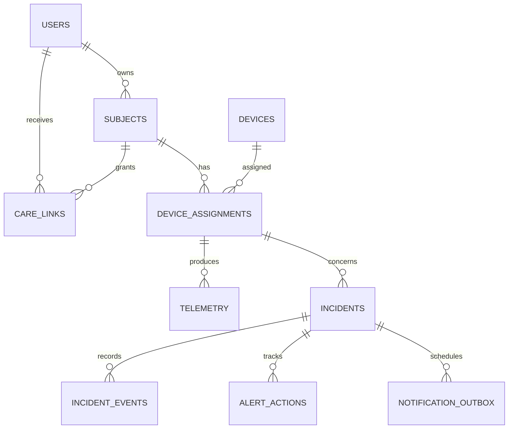

# Dữ liệu và giao tiếp

**Trạng thái:** hợp đồng v1, bổ sung trường/endpoint v2 (ngày 15/11/2026). Envelope telemetry, sự kiện incident, ACK, insights và các schema HTTP đã được zod schema trong [`packages/contracts`](../packages/contracts/README.md) thực thi. Đã có **OpenAPI 3.1** cho toàn bộ route của 21 controller backend (quản trị, trợ lý, hồ sơ, số đo, phiếu đi khám, cảnh báo, thiết bị, chia sẻ chăm sóc, lịch nhắc, liên hệ khẩn cấp, bảo trì, cấu hình chính sách, thông báo, xác thực, studio, ingest telemetry, health và realtime SSE) tại [`docs/api/openapi.v1.json`](api/openapi.v1.json), sinh schema từ Zod; artifact phủ đủ route nhưng **chưa kiểm schema/response runtime**; đã có validator nội bộ + 10 test, chưa có validator độc lập/generated client, workflow CI chưa chạy và chưa có JSON Schema catalog đầy đủ. Path trong artifact được khai báo thủ công nên vẫn phải đối chiếu controller; test `backend/test/openapi.spec.ts` kiểm đúng tập route của 21 controller. Khi tài liệu và schema lệch thì schema là nguồn kiểm. Năm payload mẫu trong `packages/contracts/examples` parse được bằng schema tương ứng (`pnpm build:contracts` rồi `node tools/docs/check-examples.mjs`), chỉ dùng dữ liệu tổng hợp.

## Mô hình dữ liệu

| Thực thể | Trường chính dự kiến | Ràng buộc quan trọng |
| --- | --- | --- |
| `users` | id, auth identity, trạng thái | Không dùng role toàn cục thay kiểm quyền trên hồ sơ |
| `sessions` | id, user_id, token_hash, created_at, expires_at, revoked_at | Cookie HttpOnly; thu hồi ngay khi logout/khóa tài khoản/đổi mật khẩu; không trả token cho client |
| `subjects` | id, owner_user_id, tên hiển thị, timezone, archived_at | Tách người được theo dõi khỏi tài khoản đăng nhập; `archived_at` chỉ ẩn khỏi danh sách/quyền truy cập, không xóa dữ liệu |
| `care_links` | subject_id, caregiver_user_id, permissions (gồm `canViewMeasurements`), shared_from, accepted_at, revoked_at | Chỉ active sau chấp nhận; giới hạn lịch sử được xem; quyền số đo tách khỏi quyền cảnh báo; kiểm lại trước khi gửi dữ liệu |
| `emergency_contacts` | id, subject_id, name, relationship, phone, is_primary, created_at | Tối đa 5/hồ sơ; đúng một liên hệ chính khi danh sách khác rỗng; chỉ chủ hồ sơ ghi |
| `devices` | id, credential_ref, firmware_version, last_seen_at | Không lưu secret thô trong log hoặc hợp đồng công khai |
| `device_assignments` | id, device_id, subject_id, started_at, ended_at | Các khoảng không chồng nhau trên một thiết bị; không viết lại lịch sử khi đổi chủ |
| `telemetry` | message_id, device_id, assignment_id, boot_id, sequence, measured_at, received_at, metrics, quality, `is_quarantined` | Chống trùng; assignment xác định theo `measured_at`; mẫu cách ly vẫn lưu nhưng không xuất hiện trên đường đọc |
| `incidents` | id, assignment_id, type, state, last_revision, detected_at, resolved_at | State gồm `suspected`, `unconfirmed`, `open`, `acknowledged`, `resolved`, `cancelled`; state transition kiểm tra trong transaction; không cho sự kiện cũ mở lại incident đã đóng |
| `incident_events` | message_id, incident_id, event_revision, type, payload, received_at | Lưu lịch sử bất biến; unique incident_id + event_revision |
| `alert_actions` | incident_id, actor_id, action, reason, created_at | Ai xác nhận/đóng và vì sao; bảo vệ tranh chấp bằng version/transaction |
| `notification_outbox` | incident_id, revision, recipient_id, channel, kind, status, attempts, next_attempt_at | `channel` hiện `in_app`/`web_push`; `dedupe_key` unique theo incident/revision/người nhận/kênh/loại (`alert`/`update`), incident/bậc/người nhận/kênh (`escalation`) hoặc hồ sơ/ngày/người nhận (`care_*`); kiểm quyền lại lúc gửi |
| `ai_summaries` | subject_id, period, aggregate_ref, source_ids, model_version, status | Chỉ lưu theo chính sách được đồng ý; mất quyền thì không đọc lại qua cache |
| `audit_logs` | actor_id, action, target_ref, outcome, created_at | Không chứa toàn bộ payload sức khỏe, credentials hay prompt riêng tư |



Khóa/index dự kiến: unique `(device_id, message_id)`, unique `(device_id, boot_id, sequence)` cho envelope thiết bị; index `(assignment_id, measured_at)` cho truy vấn biểu đồ và `(state, detected_at)` cho cảnh báo. `message_id` phải được giữ nguyên khi retry; `sequence` tăng chung cho các bản tin trong một boot. Cùng key nhưng khác nội dung là xung đột, không âm thầm overwrite.

## Hợp đồng telemetry

| Trường | Quy tắc |
| --- | --- |
| `schema_version` | `1.0` cho bản dự thảo này; version không hỗ trợ bị từ chối/cách ly có lý do |
| `message_id`, `device_id`, `boot_id` | Định danh không chứa tên/số điện thoại; ví dụ dùng ID minh họa |
| `sequence` | Số nguyên không âm; tăng trong cùng boot, giữ khi gửi lại |
| `measured_at` | RFC 3339 UTC hoặc `null` khi chưa có đồng hồ tin cậy |
| `clock_status` | `synced` hoặc `unsynced`; `unsynced` đi với `measured_at: null` |
| `uptime_ms` | Thời gian monotonic tính từ boot; không so trực tiếp giữa hai boot |
| `metrics.heart_rate_bpm` | Số hoặc `null`; chỉ số không hợp lệ phải là `null`, không dùng 0 giả |
| `metrics.steps_since_boot` | Tổng bước của boot hiện tại, số nguyên không âm; không phải tổng ngày |
| `quality.heart_rate` | `valid`, `poor_signal`, `not_worn` hoặc `sensor_error` |
| `quality.motion` | `valid` hoặc `sensor_error`; lỗi cảm biến không tự thành ít vận động |
| `battery_percent` | Số 0–100 hoặc `null` khi chưa có phép đo/cấu hình chuyển đổi |
| `firmware_version` | Phiên bản tạo payload; phiên bản demo không đại diện firmware đã build |

Server bổ sung `received_at`, `assignment_id`, cờ dữ liệu trễ và `is_quarantined`. Firmware không được tự khai người được theo dõi. Khi không đủ bằng chứng để gán dữ liệu vào lịch sử assignment, giữ bản tin ở vùng cách ly; không tự gán vào chủ hiện tại.

**Bổ sung v2 — cách ly và đồng hồ:** `clock_status=synced` bắt buộc có `measured_at`; chỉ `unsynced` được để `null` (nếu sai, HTTP trả 422 `VALIDATION_FAILED`). Mẫu có `measured_at` lệch tương lai quá `MAX_CLOCK_SKEW_SECONDS` (mặc định 120 giây, biến môi trường), trước assignment đầu tiên hoặc nằm ngoài khoảng assignment bị cách ly; mẫu trong assignment đã đóng vẫn thuộc chủ cũ. Telemetry bị cách ly trả **202 `accepted`** kèm `code=QUARANTINED` (thiết bị không retry vô hạn), được lưu với `is_quarantined=true` để giữ dedupe/bằng chứng và bị loại khỏi measurements/daily-summary/insights/export/dashboard. Mẫu `unsynced`/`null` vẫn được lưu vào assignment đang mở nhưng không lên timeline và được đếm vào `excludedUnsyncedCount`.

Tổng bước theo ngày được tính từ delta trong từng boot và gán vào khoảng có thời gian tin cậy. Lần nhận đầu của boot sau một đoạn mất dữ liệu có thể không phân bổ chính xác theo ngày; đánh dấu chưa đủ dữ liệu thay vì cộng toàn bộ vào ngày nhận. Khi counter giảm trong cùng boot, ghi lỗi dữ liệu. Ngày hiển thị theo timezone hồ sơ; lưu timestamp UTC.

## Topic và giao nhận MQTT (thử nghiệm, chưa phải đường ingest production)

**Trạng thái 21/11/2026 — HTTP là đường ingest chính thức; MQTT vẫn là profile thử nghiệm.** `POST /api/v1/ingest/telemetry` và `POST /api/v1/ingest/events` (header `x-device-id`, `x-device-key`) là đường simulator, web và test đang dùng. Adapter MQTT trong `backend` subscribe `v1/devices/+/telemetry` và `v1/devices/+/events` khi đặt `MQTT_URL`, gọi chung `TelemetryIngestService`/`IncidentsService` và publish ACK sự kiện sau commit. Phần mã/test của **P0-2** đã có; **chưa kiểm broker/ACL/TLS thật**, chưa có xác thực khóa thiết bị ở tầng ứng dụng (P0-1 mở), nên **không dùng MQTT cho demo cảnh báo**. Broker trong `infra/compose.yaml` nằm sau profile `mqtt-experimental` (tắt khi `docker compose up` mặc định), chỉ bind loopback, bắt buộc user/password + ACL theo `device_id`; xem [`infra/README.md`](../infra/README.md).

Bảng dưới là **hợp đồng topic**; cột trạng thái cho biết phần nào đã có trong code. MQTT vẫn là profile thử nghiệm, chưa kiểm broker thật.

| Topic | Hướng | Payload/chính sách | Trạng thái |
| --- | --- | --- | --- |
| `v1/devices/{device_id}/telemetry` | Thiết bị → backend | Envelope telemetry; QoS 1 đề xuất, có thể tổng hợp mẫu để giảm băng thông | Adapter đã subscribe; chưa chạy broker thật, chưa có xác thực thiết bị ở tầng ứng dụng |
| `v1/devices/{device_id}/events` | Thiết bị → backend | `fall.candidate`, `fall.cancelled`, `fall.confirmed`, `user.cancel_requested`, `sos.confirmed`; QoS 1 | **Đã có ingest** qua `IncidentsService` (cùng idempotency/quarantine với HTTP); chưa kiểm broker thật |
| `v1/devices/{device_id}/status` | Thiết bị/broker → backend | Presence/heartbeat gồm boot_id, uptime, firmware, pin nếu có; LWT chỉ là gợi ý mất kết nối | Chưa có |
| `v1/devices/{device_id}/acks` | Backend → thiết bị | ACK ứng dụng cho sự kiện quan trọng sau commit; QoS 1, không retain | **Đã publish** ACK cho sự kiện; chưa kiểm broker thật |

Khi hiện thực: không retain telemetry hoặc sự kiện té ngã — subscriber mới không được hiểu một sự kiện cũ là mới. Có thể retain presence, nhưng phải kiểm thời gian nhận. Topic status dùng cùng envelope định danh khi do thiết bị gửi; LWT do broker gửi phải được nhận diện riêng và không đưa vào bảng dữ liệu đo.

ACL phải buộc `device_id` trong topic và payload khớp định danh đã cấp; subscriber backend không tin một `device_id` chỉ vì JSON hợp lệ. Cấu hình mẫu ở `infra/mosquitto/acl` dùng username = `device_id` cho từng thiết bị, `pattern` cho publish `v1/devices/%u/telemetry`, `v1/devices/%u/events` và đọc `v1/devices/%u/acks`; backend dùng user riêng đọc telemetry/events và chỉ publish ACK. File mật khẩu tạo cục bộ ngoài repo và không commit; không dùng chung một tài khoản thiết bị cho mọi board. Certificate/credential provisioning và rotation chưa được hiện thực cho MQTT (P1-2), và ACL/TLS chưa được kiểm với broker thật.

## Incident và ACK

Sự kiện dùng envelope như telemetry, thay `metrics` bằng `incident_id`, `event_revision`, `event_type` và `evidence`. `event_revision` bắt đầu 1 ở candidate, tăng theo từng thay đổi của incident và cần phục hồi được sau reboot nếu incident còn mở. `fall.confirmed` phải mang đủ dữ liệu để xử lý khi candidate chưa đến.

`evidence.algorithm_version`, vị trí đeo và cờ chất lượng giúp giải thích nguyên nhân; không gọi một điểm heuristic là “xác suất té ngã” nếu chưa hiệu chuẩn.

**Bổ sung v2 — assignment và quarantine sự kiện:** dedupe theo `(device_id, message_id)` chạy trước; assignment được tra theo `measured_at` trên toàn bộ lịch sử, khoảng nửa mở `[started_at, ended_at)`, không nới biên. `measured_at=null`, trước assignment đầu tiên, ngoài khoảng assignment hoặc lệch tương lai quá ngưỡng bị cách ly. Nếu incident đã tồn tại nhưng assignment theo `measured_at` thuộc hồ sơ khác, trả `rejected` + `QUARANTINED` lý do `assignment_mismatch`, không ghi vào incident của chủ cũ. Sự kiện cách ly **không** tạo incident/outbox/SSE; HTTP trả **202** với `status=rejected`, `incidentId=null`, `acceptedRevision=null`, message tiếng Việt. Audit chỉ ghi id bản tin, thời gian, lý do và độ lệch, không ghi evidence/nhịp tim/điện thoại.

Sau khi quá hạn không có kết quả cuối, job nền chuyển `suspected → unconfirmed` (mặc định 10 phút, cấu hình `SUSPECTED_TIMEOUT_MINUTES`). `unconfirmed` là bản ghi “thiếu kết quả cuối”, không phát SSE/outbox; nếu confirmed đến muộn, incident mở lại `open`.

ACK dùng camelCase như mọi response HTTP: `status` (`accepted`/`duplicate`/`rejected`), `sourceMessageId`, `receivedAt`, `incidentId` (ID server dạng UUID, khác `incident_id` do thiết bị sinh), `acceptedRevision` và `code`/`message` (`null` khi không lỗi). `accepted` nghĩa server đã ghi bền; `duplicate` nghĩa bản tin giống hệt đã được ghi; `rejected` kèm `code` lý do để không retry vô hạn. Thiết bị chỉ xóa sự kiện khỏi hàng đợi sau ACK accepted/duplicate đúng định danh; bản tin bị reject chuyển vùng lỗi hữu hạn để kiểm tra. Schema thực thi là `ingestAckSchema`; adapter MQTT publish ACK sự kiện qua `v1/devices/{id}/acks` sau commit — đây là profile thử nghiệm, chưa kiểm broker thật; xem [docs/14](14-ke-hoach-trien-khai-phan-mem.md) mục 11.

Nếu revision mới tới trước revision cũ, server lưu lịch sử và áp dụng transition hợp lệ theo revision mới; bản cũ tới sau không làm lùi trạng thái. Hai payload khác nhau cùng revision là lỗi giao thức cần audit. Chuyển `cancelled` sang `open` bằng dữ liệu cũ bị cấm.

## API v1

Prefix `/api/v1`. Phần lớn endpoint dưới đây **đã chạy** trong `backend` (NestJS) và được web/simulator dùng; chỉ dòng ghi rõ "chưa triển khai" là thiết kế. Bảng rút gọn theo nhóm — danh sách đầy đủ lấy từ controller trong `backend/src/*/*.controller.ts`, request/response chi tiết ở `packages/contracts`.

| Nhóm | Endpoint | Trạng thái / kiểm quyền |
| --- | --- | --- |
| Health | `GET /health` | Đã có; công khai, trả trạng thái DB và AI |
| Phiên và tài khoản | `POST /auth/register`, `/auth/login`, `/auth/logout`; `GET /me`; `PATCH /me`; `POST /me/password`; `GET /me/sessions`; `DELETE /me/sessions/:id`; `POST /me/sessions/revoke-others` | Đã có; cookie HttpOnly + SameSite=Lax, kiểm Origin cho thao tác ghi, rate limit đăng nhập sai. Đổi mật khẩu thu hồi mọi phiên khác; không trả token/hash |
| Hồ sơ | `GET/POST /subjects`, `GET/PATCH /subjects/:id`, `GET /subjects/:id/status`, `POST /subjects/:id/archive`, `POST /subjects/:id/deletion-requests` | Đã có; chỉ hồ sơ sở hữu/được chia sẻ. Archive 204, thu hồi care link, không xóa dữ liệu; deletion-request 202 `recorded`, chỉ ghi audit |
| Chia sẻ | `GET/POST /subjects/:id/invitations`; `GET /invitations/:token`; `POST /invitations/:token/accept`; `GET /subjects/:id/care-links`; `DELETE /subjects/:id/care-links/:linkId` | Đã có; chủ hồ sơ tạo/thu hồi; token dùng một lần, có hạn; quyền gồm `canViewMeasurements`; không ghi token vào log |
| Liên hệ khẩn cấp | `GET/POST /subjects/:id/emergency-contacts`; `PATCH/DELETE /subjects/:id/emergency-contacts/:contactId` | Đã có; tối đa 5; owner ghi, caregiver có `canReceiveAlerts` đọc; số điện thoại không vào audit/log |
| Thiết bị | `POST /subjects/:id/devices/claim`; `GET /subjects/:id/devices`; `POST /devices/:id/release` | Đã có; bằng chứng ghép thiết bị dùng một lần; assignment đóng/mở đúng thời điểm; `/status` và `/devices` có `healthDataVisible` |
| Thiết bị (admin) | `GET/POST /admin/devices`; `POST /admin/devices/:id/claim-code`; `POST /admin/devices/:id/rotate-key` | Đã có; tạo thiết bị và khóa/mã chỉ trả một lần; UI admin có danh sách/cấp mã/xoay khóa, chưa có form tạo |
| Ingest | `POST /ingest/telemetry`, `POST /ingest/events` (header `x-device-id`, `x-device-key`) | Đã có; xác thực khóa thiết bị, không dùng cookie người dùng; ack có thể là `accepted`/`duplicate`/`rejected` với `code=QUARANTINED`. **Đây là đường ingest chính thức**; MQTT chỉ là profile thử nghiệm, đã có ingest sự kiện/ACK trong mã nhưng chưa kiểm broker thật |
| Đo | `GET /subjects/:id/measurements?from=&to=&cursor=`; `GET /subjects/:id/daily-summary?date=`; `GET /subjects/:id/insights?days=7..30`; `GET /subjects/:id/export.csv` | Đã có; giới hạn khoảng, pagination, quyền lịch sử và `canViewMeasurements`; insights trả ngày thiếu với `hasData=false`, không nội suy |
| Cảnh báo | `GET /subjects/:id/alerts`; `GET /alerts/:id`; `POST /alerts/:id/acknowledge`; `POST /alerts/:id/resolve` | Đã có; chi tiết trả `recipients[].deliveries` (kind/kênh/trạng thái/thời điểm) cho người có quyền; ack/resolve compare-and-set; 403 khi có link nhưng thiếu quyền nhận cảnh báo, 404 khi không có link hoặc incident đang `suspected`; `unconfirmed` nằm trong tab Đã đóng |
| Realtime | `GET /subjects/:id/events` (SSE) | Đã có; xác thực stream, kiểm lại phiên/trạng thái người dùng + quyền mỗi vòng; `event: revoked` khi mất quyền/khóa tài khoản; reconnect bằng cursor/`Last-Event-ID` |
| Thông báo | `GET /notifications`; `POST /notifications/:id/read` | Đã có; outbox giao trong ứng dụng; hộp thông báo toàn tài khoản ở `/app/alerts?view=notifications` và banner thông báo mới ở web. Badge trên nav đếm **cảnh báo đang mở**, không phải số thông báo chưa đọc |
| Tuỳ chọn nhận thông báo | `GET/PUT /me/notification-preferences`; `GET/POST/DELETE /me/push-subscriptions` | **Đã có backend V10b**, mặc định tắt: in-app luôn bật; Web Push cần `WEB_PUSH_ENABLED`, VAPID và subscription HTTPS. Chỉ trả id/host + `webPushPublicKey` (khóa công khai VAPID) khi bật, không trả endpoint/khóa subscription; chặn endpoint IP/localhost; xoá subscription khi push service trả 404/410. **Chưa có service worker/UI** |
| Chính sách leo thang cảnh báo | `GET /subjects/:id/alert-policy`; `PUT /subjects/:id/alert-policy`; `POST /subjects/:id/alert-policy/previews` | **Đã có backend V10a** (chưa có UI): chỉ chủ hồ sơ; mặc định tắt; tối đa 3 mốc tăng dần, kênh `in_app`; preview không ghi, trả người nhận hiện tại + cảnh báo nếu không có người nhận. Scheduler chỉ leo thang incident `open`, dừng khi ack/đóng/mất quyền; Web Push là kênh phụ sau cờ, SMS chưa có |
| AI | `GET /subjects/:id/assistant/summary`; `POST /subjects/:id/assistant/ask` | Đã có; kiểm `canViewMeasurements` + `canViewAi` trước tổng hợp và trước trả kết quả; response có `dataQuality`; fallback template khi chưa cấu hình provider |
| Hành động trợ lý | `GET /subjects/:id/assistant/capabilities`; `GET /subjects/:id/assistant/drafts`; `POST /subjects/:id/assistant/drafts`; `POST /subjects/:id/assistant/drafts/from-text`; `GET /assistant/drafts/:id`; `PATCH /assistant/drafts/:id`; `POST /assistant/drafts/:id/confirm`; `POST /assistant/drafts/:id/cancel` | **FR-21 backend**: nháp `care_reminder.create`/`maintenance_task.create`, owner-only; tạo nháp **không ghi** `care_reminders`/`maintenance_tasks`; confirm tạo lịch hoặc task trong cùng transaction, lặp lại không nhân đôi; hết hạn/hủy/digest sai → 409. `from-text` dùng parser rule-based cho câu đơn giản, không LLM; từ chối liều lượng/khoảng tương đối; hiểu ngày kết thúc dạng ngày/tháng(/năm), không tự đoán năm kế tiếp; mặc định cả tuần, dời sang mai nếu mọi giờ hôm nay đã qua. `PATCH` chỉ sửa nháp `draft` còn hạn, cập nhật digest. Danh sách chỉ trả nháp `draft` còn hạn của chủ hồ sơ, sớm hết hạn trước. Tạo nháp nhận `requestKey` tùy chọn để retry idempotent; cùng khóa khác nội dung/khác capability → 409. Nháp task kiểm thiết bị còn gắn hồ sơ khi confirm. Chưa có UI |
| Bảo trì | `GET /maintenance-tasks`; `POST /maintenance-tasks`; `POST /maintenance-tasks/:id/close` | Đã có; chủ hồ sơ tạo việc cho thiết bị đang gắn; đóng task cần lý do; caregiver chỉ xem |
| Studio | `GET/POST /workspace-views`; `GET /workspace-views/:id`; `PUT /workspace-views/:id/draft`; `POST /workspace-views/:id/previews`; `POST /workspace-views/:id/publications`; `POST /workspace-views/:id/rollback`; `GET /workspace-views/:id/publications`; `GET /workspace-views/:id/data` | Đã có; preview chỉ đọc, publish CAS `baseRevision + digest`; dữ liệu theo `sharedFrom`/`historyDays` và quyền cảnh báo |
| Admin | `GET /admin/users`; `PATCH /admin/users/:id/status`; `GET /admin/audit`; `GET /admin/policies/:key`; `POST /admin/policies/:key/previews`; `PUT /admin/policies/:key`; `GET /admin/overview`; `GET /admin/retention/preview`; `GET /admin/jobs`; `GET /admin/outbox/summary` | Đã có; không cấp payload sức khỏe mặc định cho admin kỹ thuật; khóa tài khoản thu hồi phiên/SSE. Retention preview chỉ đếm theo env hiện tại, không xóa/không đổi cấu hình. `GET /admin/jobs` chỉ đọc `job_runs` (3 job cố định, counter vận hành), không chạy lại job, không audit. `GET /admin/outbox/summary` chỉ đếm outbox theo trạng thái/kênh/kind, không trả title/body/người nhận/lỗi gửi. |

**OpenAPI (21/11/2026, phủ đủ route ngày 22/11/2026):** [`docs/api/openapi.v1.json`](api/openapi.v1.json) mô tả 79 path/99 operation của quản trị, trợ lý, hồ sơ, số đo, phiếu đi khám, cảnh báo, thiết bị, chia sẻ chăm sóc, lịch nhắc, liên hệ khẩn cấp, bảo trì, cấu hình chính sách, thông báo, xác thực, studio, ingest telemetry, health và realtime SSE; request/response schema sinh từ `packages/contracts` bằng `z.toJSONSchema`. Test `backend/test/openapi.spec.ts` so **đúng tập route** của toàn bộ 21 controller backend với artifact, nên route không thừa/thiếu; tuy vậy artifact vẫn khai báo path thủ công và **chưa chứng minh schema/response runtime**, chưa có validator độc lập/Generated client/CI. Không thay bảng endpoint/controller. Sinh/kiểm bằng `pnpm openapi:generate` và `pnpm openapi:check`; artifact được commit để review.

Lỗi API dùng envelope `{ "code": "...", "message": "...", "requestId": "..." }`; không trả stack trace hoặc thông tin hồ sơ khác. Dùng `401` khi không có phiên, `403` khi bị cấm theo chính sách, `409` khi xung đột trạng thái/version theo contract nghiệp vụ, `422` khi payload không phù hợp hợp đồng, `429` khi vượt giới hạn. Nếu dùng conditional update với `If-Match`/strong ETag, precondition không thỏa thì trả `412 Precondition Failed`, không thay bằng `409`. Quy ước này đối chiếu RFC 9110; endpoint phải nói rõ ETag thuộc tài nguyên nào, xem [đặc tả AI, mục 9](13-dac-ta-thuc-thi-ai-va-cau-hinh.md). Với cảnh báo, quy ước đã chạy: có link hồ sơ nhưng thiếu `canReceiveAlerts` → `403`; không có link hoặc incident đang `suspected` → `404` để không dò tồn tại.

**Bổ sung v2 — mã trạng thái theo endpoint:**

| Endpoint/hành vi | Thành công | Lỗi thường gặp |
| --- | --- | --- |
| `PATCH /me` | 200 `{user}` | 400 tên rỗng/quá dài, 401 |
| `POST /me/password` | 204 | 400 mật khẩu hiện tại sai/không đổi/không đủ mạnh, 401 |
| `GET /me/sessions` | 200 `{items}` | 401; không trả token/hash |
| `DELETE /me/sessions/:id` | 204 (idempotent nếu đã thu hồi) | 400 nếu là phiên hiện tại, 404 nếu không thuộc mình |
| `POST /subjects/:id/archive` | 204 | 400 `confirmationName` không khớp, 403 caregiver, 404 không có quyền/không tồn tại, 409 đã lưu trữ |
| `POST /subjects/:id/deletion-requests` | 202 `{id,status:'recorded',recordedAt,note}` | 400/403/404 như trên; **không xóa dữ liệu** |
| `GET/POST /subjects/:id/emergency-contacts` | 200/201 | 403 caregiver ghi hoặc thiếu `canReceiveAlerts` khi đọc, 404 ngoài hồ sơ, 409 quá 5 liên hệ |
| `PATCH/DELETE .../emergency-contacts/:contactId` | 200/204 | 400 bỏ primary khi còn liên hệ khác, 404 sai hồ sơ, 403 caregiver |
| `GET /subjects/:id/insights` | 200 | 400 `days` ngoài 7..30/không phải số, 403 thiếu `canViewMeasurements`, 404 ngoài hồ sơ |
| `POST /maintenance-tasks` | 201 task | 400 thiết bị không gắn/hạn quá khứ, 403 caregiver, 404 ngoài hồ sơ |
| `POST /ingest/telemetry` | 202 `accepted`/`duplicate` | 401/403 khóa thiết bị, 422 payload sai hợp đồng, 202 + `code=QUARANTINED` khi cách ly |
| `POST /ingest/events` | 202 `accepted`/`duplicate`/`rejected` | 401/403 khóa thiết bị, 422 payload sai, 202 `rejected` + `QUARANTINED` khi cách ly, 409 xung đột revision/message |
| SSE `/subjects/:id/events` | 200 stream | 401 chưa đăng nhập, 403 thiếu `canReceiveAlerts`, 404 ngoài hồ sơ; `event: revoked` khi mất quyền/phiên |

`403` và `404` không thay thế nhau tùy tiện: tài nguyên riêng tư không có quyền trả `404` để tránh dò tồn tại; người đã có link nhưng thiếu một quyền cụ thể (ví dụ `canViewMeasurements`/`canReceiveAlerts`) trả `403` kèm thông điệp nghiệp vụ. Quy ước này áp cho measurements, insights, export, devices/status, emergency contacts, Studio và assistant.

## Retention và xóa

Trước dữ liệu thật, chốt thời hạn cho raw signal, telemetry tổng hợp, audit, AI và backup. Raw IMU/PPG chỉ thu trong phiên thử có mục đích, không truyền/lưu liên tục mặc định. Một yêu cầu xóa phải xét database, file export, cache, tóm tắt AI và vòng đời backup; không ghi “đã xóa hết” khi mới ẩn trên giao diện.

**Hiện trạng 21/11/2026:** `POST /subjects/:id/archive` chỉ đặt `archived_at`, thu hồi care link và ghi audit; telemetry/cảnh báo/bản xuất vẫn còn. `POST /subjects/:id/deletion-requests` chỉ ghi audit `subject.deletion_request` với `status=recorded` và trả `note` nói rõ dữ liệu chưa bị xóa. Đã có **retention job tùy chọn, mặc định tắt** cho telemetry/outbox/realtime/AI summary/nháp trợ lý đã hết hạn khi cấu hình `RETENTION_*`; job chạy một lần/ngày, xóa theo lô và ghi audit `retention.purge`. **Chưa có** xóa cứng toàn bộ hồ sơ, xóa bản export/AI cache/backup, API/UI cấu hình hay thời hạn xử lý yêu cầu. Vì vậy không được mô tả hai endpoint này là “đã xóa dữ liệu”.

Tài khoản người thân đã bị thu hồi không nhận notification còn trong hàng đợi và không đọc bản tóm tắt cache. Dữ liệu đã xuất ra ngoài cần được giải thích trong chính sách chia sẻ trước khi sử dụng thực tế.

## Payload mẫu

Năm payload tổng hợp dùng để kiểm schema; không có dữ liệu người thật:

| File | Nội dung | Schema |
| --- | --- | --- |
| [`telemetry.v1.json`](../packages/contracts/examples/telemetry.v1.json) | Một mẫu BPM/bước chân trong boot | `telemetryEnvelopeSchema` |
| [`fall-confirmed.v1.json`](../packages/contracts/examples/fall-confirmed.v1.json) | Confirmed đến sau cửa sổ hủy | `incidentEnvelopeSchema` |
| [`event-ack.v1.json`](../packages/contracts/examples/event-ack.v1.json) | ACK đã lưu bản tin incident | `ingestAckSchema` |
| [`event-ack-quarantined.v1.json`](../packages/contracts/examples/event-ack-quarantined.v1.json) | ACK sự kiện bị cách ly, `incidentId=null` | `ingestAckSchema` |
| [`insights.v1.json`](../packages/contracts/examples/insights.v1.json) | Xu hướng ngày có dữ liệu và ngày thiếu | `insightsResponseSchema` |

Ví dụ ACK cách ly (không tạo incident):

```json
{
  "status": "rejected",
  "sourceMessageId": "msg-demo-quarantine-0001",
  "receivedAt": "2026-11-15T08:00:00Z",
  "incidentId": null,
  "acceptedRevision": null,
  "code": "QUARANTINED",
  "message": "Sự kiện đã bị cách ly để kiểm tra thời gian hoặc assignment; không tạo cảnh báo."
}
```

Chạy `pnpm build:contracts && node tools/docs/check-examples.mjs` để kiểm mọi file mẫu; script fail nếu thêm file mà chưa khai báo schema.
